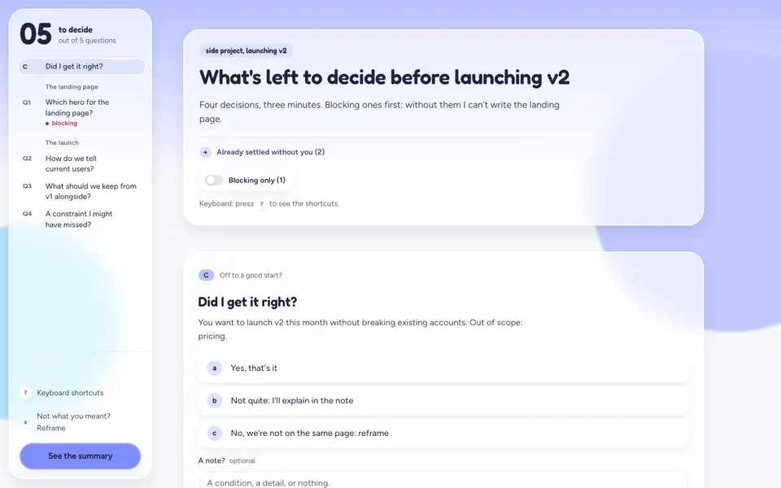
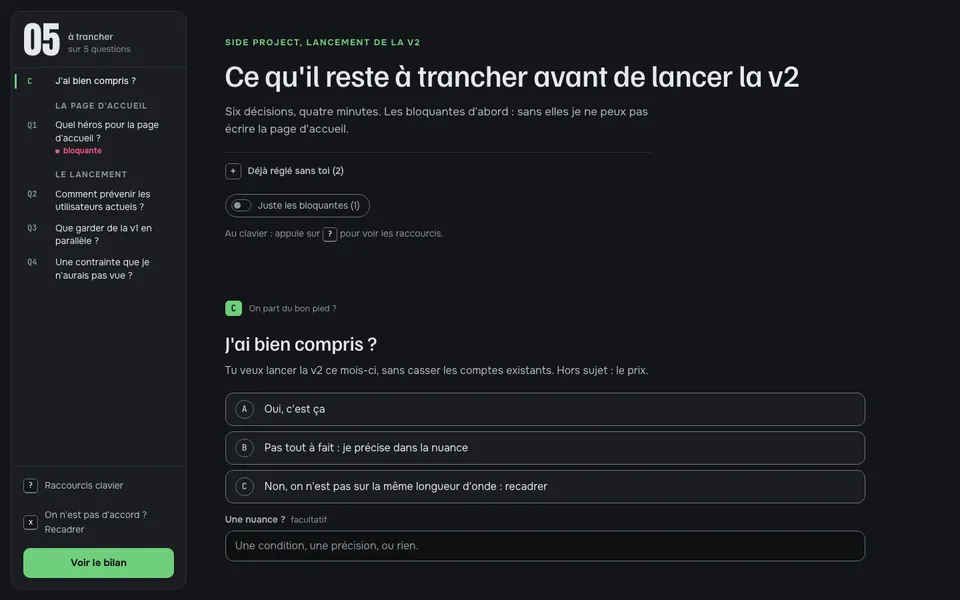
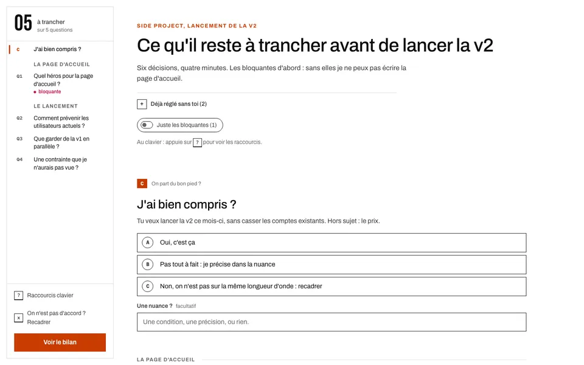

<div align="center">

# /quizz

**Les questions en attente deviennent un quiz cliquable. Claude applique tes réponses.**

Un plugin Claude Code : au lieu d'un pavé de questions dans le terminal, Claude publie une page où tu tranches en quelques clics, avec ses recos, ce que chaque choix implique, et des visuels rendus pour de vrai.

[](https://github.com/AThevon/quizz/releases)
[](LICENSE)
[](https://docs.claude.com/en/docs/claude-code/plugins)
[](https://claude.ai)
[](#prérequis)
[](#thèmes)
[](https://github.com/AThevon/quizz/commits/main)


</div>

## Pourquoi

Quand une tâche a cinq décisions en suspens, les poser dans le terminal donne un pavé qu'on lit en diagonale. `/quizz` en fait une page : une question par décision, des options courtes, la reco de Claude, et ce qu'un choix coûte avant que tu le prennes. Tu réponds en deux minutes, Claude relit, applique, et écrit dans la page ce qu'il a fait.

Pour quatre questions ou moins, Claude les pose directement dans le terminal. Au-delà, ou dès qu'un choix se regarde (une maquette, une palette), il te propose un quiz.

## Comment ça marche

1. **Claude rassemble ce qui lui manque** : les choix qui lui reviennent pour avancer, groupés, les bloquants d'abord, chacun avec sa reco.
2. **Il publie le quiz** dans un artefact claude.ai : tu cliques, tu nuances, tu laisses Claude trancher où ça t'est égal, puis « Envoyer mes réponses ».
3. **Il applique** : il relit tes réponses depuis la page, fait le travail, et y écrit ce qu'il a appliqué, ses prédictions sur tes réponses et la suite possible.

## Installer

Dans Claude Code :

```
/plugin marketplace add AThevon/quizz
/plugin install quizz@quizz
```

Puis relance Claude Code (ou `/reload-plugins`). La première fois qu'un quiz s'ouvre, claude.ai demande l'accord pour que la page puisse poser des questions à Claude : accepte.

Pour recevoir les nouvelles versions : `/plugin`, onglet Marketplaces, `quizz`, Enable auto-update.

## Commandes

| commande | ce qu'elle fait |
|---|---|
| `/quizz` | un quiz sur les questions ouvertes de la session. Claude te le propose aussi tout seul quand il en a plusieurs |
| `/quizz <sujet>` | un quiz sur un sujet précis |
| « à plusieurs » | au lancement ou plus tard : le quiz devient partageable, avec relecture et arbitrage des divergences |
| `/quizz thème` | choisis l'apparence de tes quiz parmi les thèmes livrés, sur un aperçu |
| `/quizz thème <description>` | Claude te propose trois thèmes sur mesure, tu gardes celui qui te plaît |

## Dans la page

**Répondre**
- Une réponse en un clic, une nuance si besoin, « À toi de voir » pour laisser Claude trancher, « J'y tiens / Peu importe ».
- Des visuels quand la question se regarde : Claude dessine les variantes (maquette, palette, mise en page, schéma), rendues pour de vrai sur chaque option, ou y met une capture. Chacun garde sa forme, un clic l'agrandit. Avant de publier, Claude les rend dans Chrome sans écran et mesure ce qui cloche (débordement, texte coupé, contraste).
- Un sommaire qui montre ce qui reste à trancher, avec un seul signal pour ce qui demande ton attention.
- Des questions qui apparaissent selon tes réponses, des questions bloquantes, et le mode « Juste les bloquantes ».
- Tout au clavier : `a` `b` `c` pour choisir, `r` pour la reco, `j` `k` pour avancer, `?` pour l'aide.

**Comprendre**
- Creuser (`q`) : demande à Claude d'expliquer une question sans quitter la page. Sa réponse s'écrit mot à mot, mise en page, puis se copie.
- Recadrer (`x`) : si le quiz part de travers, dis ce qui cloche, Claude réécrit les questions.
- Des messages prêts à copier (Slack, mail, DM) quand une décision appelle un message, dans ton ton. Rien n'est envoyé à ta place.

**Après l'envoi**
- Ce que Claude a appliqué, ses prédictions sur tes réponses, et « Approfondir » pour le tour suivant.
- Un registre des décisions commun à tous tes projets (son lien vit dans `~/.claude/quizz-registre.json`).

## À plusieurs

Dis « à plusieurs » et ça devient une sorte de prompting multijoueur. Les questions viennent de l'agent qui a le contexte (le code, tes outils) et qui implémentera ensuite : ce qui lui manque, ce sont les choix, et on peut être plusieurs à les lui donner.

- Tu partages le lien (droit Contributeur). Les autres relisent tes choix et ne répondent que là où ils ne sont pas d'accord : une question laissée vide vaut accord.
- Quand quelqu'un choisit une option coûteuse ou propose autre chose, la page lui dit avant l'envoi ce que ça demande (léger, moyen, lourd), sans jamais bloquer.
- Tu règles chaque divergence dans la page (garder ta réponse, retenir la leur, une synthèse de Claude, ou à discuter), puis « Appliquer » : c'est toujours toi qui lances l'implémentation.

Pour répondre à un quiz qu'on te partage, rien à installer : le lien suffit, connecté à claude.ai.

## Thèmes

Cinq thèmes livrés, en clair et en sombre quand le thème a les deux. La mise en page ne change jamais : seuls les couleurs, les polices, les arrondis, la densité et la matière bougent.

<table>
  <tr>
    <td width="50%"><br><b>homie</b> : la bulle de verre de la suite Homie. Ciel pastel, panneaux de verre laiteux, très arrondi, Fredoka et Figtree.</td>
    <td width="50%"><br><b>ardoise</b> : le thème d'origine et celui par défaut. Ardoise foncée, un seul accent vert, tampons en Anton.</td>
  </tr>
  <tr>
    <td><br><b>papier</b> : gris papier et encre bleu-vert, aéré, fait pour lire longtemps.</td>
    <td><br><b>cobalt</b> : bleu cobalt profond, accent chartreuse, angles doux.</td>
  </tr>
  <tr>
    <td><br><b>signal</b> : blanc, noir et orange de balisage, compact, pour les quiz courts.</td>
    <td>
      <b>Changer de thème</b><br><br>
      <code>/quizz thème</code> : un aperçu des thèmes livrés, tu choisis.<br><br>
      <code>/quizz thème sombre, bleu nuit, très arrondi</code> : trois propositions sur mesure.<br><br>
      Ton choix vit dans <code>~/.claude/quizz-theme.json</code> et vaut pour tous tes quiz. La page le rappelle dans son aide <code>?</code>.
    </td>
  </tr>
</table>

Un thème perso part d'une base et ne donne que ce qui change. Le format complet est dans [`skills/quizz/references/themes.md`](skills/quizz/references/themes.md). La lisibilité est garantie au build : les couleurs trop pâles sont corrigées juste assez, en gardant leur teinte.

## Prérequis

- Claude Code récent, connecté avec un compte claude.ai (les artefacts doivent être disponibles sur ton compte). Pour lancer tes propres quiz, il faut Claude Code : le terminal ou l'onglet Code de l'app Claude desktop, pas le chat claude.ai.
- `python3`, bibliothèque standard uniquement.
- Chrome ou Chromium pour vérifier les visuels (facultatif ; `QUIZZ_CHROME` pour en désigner un).

Si tu avais installé une ancienne version à la main dans `~/.claude/skills/quizz`, supprime ce dossier : sinon deux `/quizz` se concurrencent.

## Licence

[MIT](LICENSE), par Adrien Thevon.
