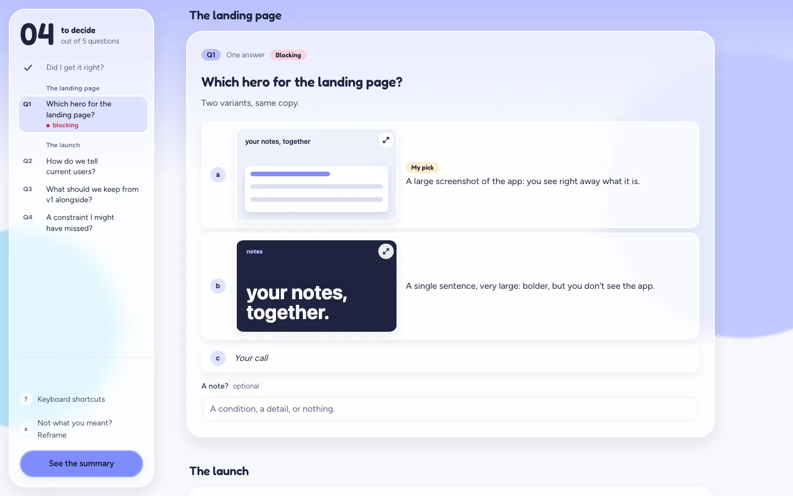
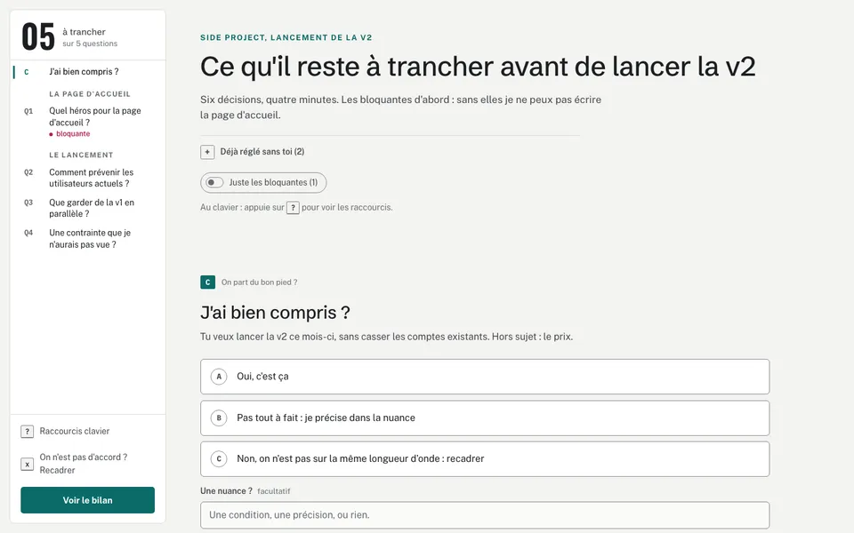
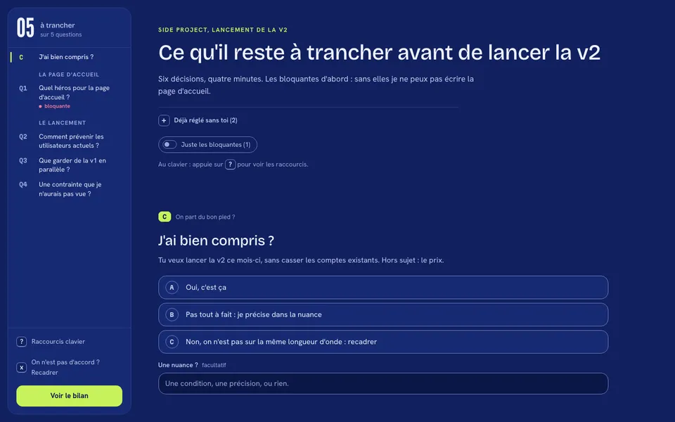

<div align="center">

# /quizz

**Pending questions become a clickable quiz. Claude applies your answers.**

A Claude Code plugin: instead of a wall of questions in the terminal, Claude publishes a page where you decide in a few clicks, with its recommendations, what each choice implies, and visuals that are actually rendered.

[](https://github.com/AThevon/quizz/releases)
[](LICENSE)
[](https://docs.claude.com/en/docs/claude-code/plugins)
[](https://claude.ai)
[](#requirements)
[](#themes)
[](#in-the-page)
[](https://github.com/AThevon/quizz/commits/main)



</div>

## Why

When a task has five decisions pending, asking them in the terminal gives you a block of text you end up skimming. `/quizz` turns it into a page: one question per decision, short options, Claude's pick, and what a choice costs before you make it. You answer in two minutes, Claude reads your answers, applies them, and writes in the page what it did.

For four questions or fewer, Claude asks them right in the terminal. Beyond that, or as soon as a choice is something you need to look at (a mockup, a palette), it offers you a quiz.

## How it works

1. **Claude gathers what it's missing**: the choices it needs from you to move forward, grouped, blocking ones first, each with its pick.
2. **It publishes the quiz** as a claude.ai artifact: you click, add a note where needed, leave it to Claude where you don't mind, then "Send my answers".
3. **It applies**: it reads your answers back from the page, does the work, and writes there what it applied, its predictions about your answers and what could come next.

## Install

In Claude Code:

```
/plugin marketplace add AThevon/quizz
/plugin install quizz@quizz
```

Then restart Claude Code (or `/reload-plugins`). The first time a quiz opens, claude.ai asks for permission to let the page ask Claude questions: accept.

To get new versions: `/plugin`, Marketplaces tab, `quizz`, Enable auto-update.

## Commands

| command | what it does |
|---|---|
| `/quizz` | a quiz on the open questions of the session. Claude also offers it on its own when it has several |
| `/quizz <topic>` | a quiz on a specific topic |
| "with others" | at launch or later: the quiz becomes shareable, with review and settling of disagreements |
| `/quizz theme` | pick how your quizzes look among the built-in themes, from a preview |
| `/quizz theme <description>` | Claude suggests three custom themes, you keep the one you like |

## In the page

The quiz is written in your language. The page interface exists in English and in French: Claude sets it from the language you use with it.

**Answering**
- An answer in one click, a note if needed, "Your call" to let Claude decide, "Matters to me / Either way".
- Visuals when the question is something to look at: Claude draws the variants (mockup, palette, layout, diagram), rendered for real on each option, or adds a screenshot. Each keeps its shape, a click enlarges it. Before publishing, Claude renders them in headless Chrome and measures what's off (overflow, clipped text, contrast).
- An overview showing what's left to decide, with a single signal for what needs your attention.
- Questions that appear depending on your answers, blocking questions, and a "Blocking only" mode.
- Everything from the keyboard: `a` `b` `c` to choose, `r` for the pick, `j` `k` to move, `?` for help.

**Understanding**
- Dig in (`q`): ask Claude to explain a question without leaving the page. Its answer streams in word by word, formatted, then can be copied.
- Reframe (`x`): if the quiz goes off track, say what's off and Claude rewrites the questions.
- Ready-to-copy messages (Slack, email, DM) when a decision calls for one, in your tone. Nothing is sent for you.

**After sending**
- What Claude applied, its predictions about your answers, and "Go deeper" for the next round.
- A decision log shared by all your projects (its link lives in `~/.claude/quizz-registre.json`).

## With others

Say "with others" and it becomes a kind of multiplayer prompting. The questions come from the agent that has the context (the code, your tools) and will implement afterwards: what it lacks are the choices, and several people can give them.

- You share the link (Contributor access). The others review your choices and only answer where they disagree: a question left blank counts as agreement.
- When someone picks a costly option or suggests something else, the page tells them before sending what it would take (light, medium, heavy), without ever blocking.
- You settle each disagreement in the page (keep your answer, go with theirs, a synthesis from Claude, or to discuss), then "Apply": you're always the one who starts the implementation.

To answer a quiz someone shares with you, there's nothing to install: the link is enough, signed in to claude.ai.

## Themes

Five built-in themes, light and dark when the theme has both. Bubble is the default one. The layout never changes: only colors, fonts, corner radius, density and material move.

<table>
  <tr>
    <td width="50%"><br><b>bubble</b>: the default theme, a glass bubble. Pastel sky, milky glass panels, very rounded, Fredoka and Figtree.</td>
    <td width="50%"><br><b>ardoise</b>: the original theme. Dark slate, a single green accent, stamps in Anton.</td>
  </tr>
  <tr>
    <td><br><b>papier</b>: paper grey and blue-green ink, airy, made for reading at length.</td>
    <td><br><b>cobalt</b>: deep cobalt blue, chartreuse accent, soft corners.</td>
  </tr>
  <tr>
    <td><br><b>signal</b>: white, black and safety orange, compact, for short quizzes.</td>
    <td>
      <b>Changing the theme</b><br><br>
      <code>/quizz theme</code>: a preview of the built-in themes, you choose.<br><br>
      <code>/quizz theme ardoise</code>: straight to a built-in theme.<br><br>
      <code>/quizz theme dark, midnight blue, very rounded</code>: three custom suggestions.<br><br>
      Your choice lives in <code>~/.claude/quizz-theme.json</code> and applies to all your quizzes. The page reminds you of it in its <code>?</code> help.
    </td>
  </tr>
</table>

A custom theme starts from a base and only gives what changes. The full format is in [`skills/quizz/references/themes.md`](skills/quizz/references/themes.md). Readability is guaranteed at build time: colors that are too faint are corrected just enough, keeping their hue.

## Requirements

- A recent Claude Code, signed in with a claude.ai account (artifacts must be available on your account). To start your own quizzes you need Claude Code: the terminal or the Code tab of the Claude desktop app, not the claude.ai chat.
- `python3`, standard library only.
- Chrome or Chromium to check the visuals (optional; `QUIZZ_CHROME` to point to one).

If you installed an old version by hand in `~/.claude/skills/quizz`, delete that folder: otherwise two `/quizz` compete.

## License

[MIT](LICENSE), by Adrien Thevon.
